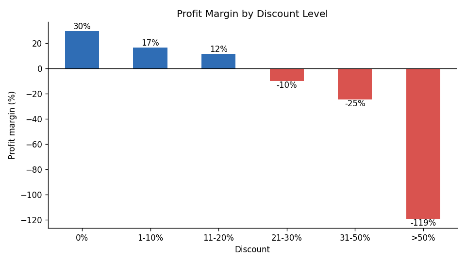
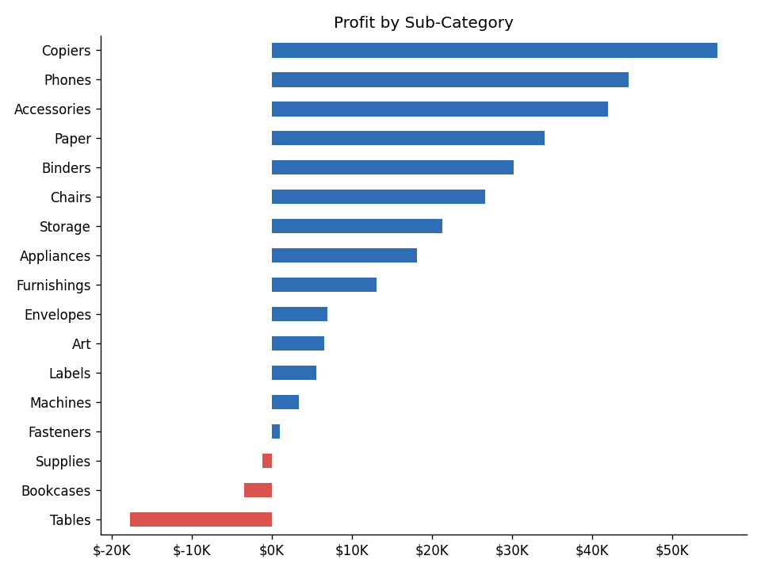
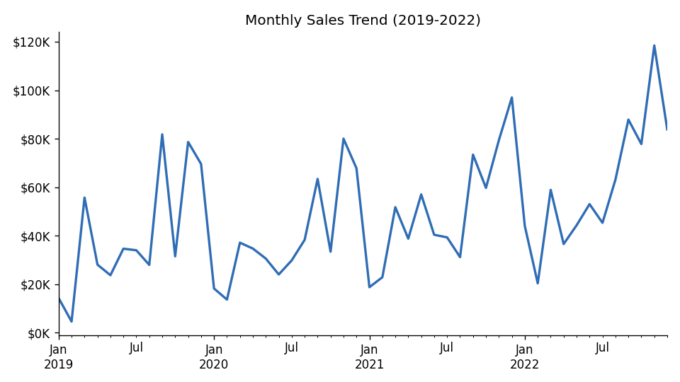
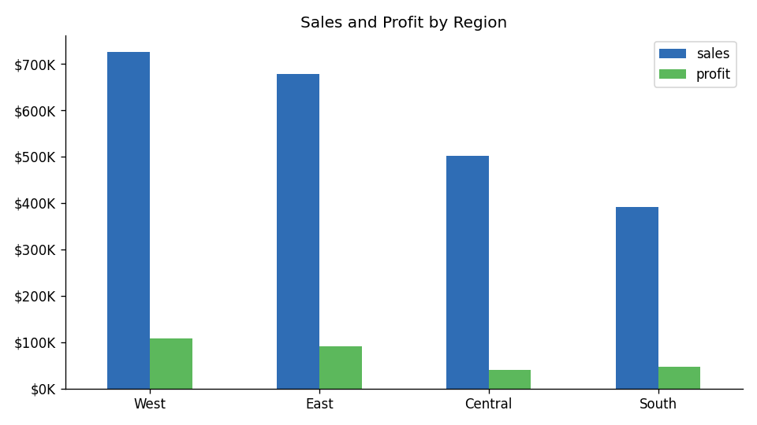

# Sales Performance Analytics Dashboard

**Tools:** SQL (SQLite), Power BI, Excel, Python (for loading and charts)

## Business Problem
A US retail superstore sells Furniture, Office Supplies and Technology products. Sales are growing, but **profit margin is only 12.5%**. Management wants to know:
- Which regions, categories and products drive (or destroy) profit?
- How do discounts affect profitability?
- What should be changed to improve margin?

## Dataset
Sample Superstore: **9,994 order lines** (2019–2022), 20 columns: order, customer, region, product, sales, quantity, discount, profit. File: `data/superstore.csv`

## Approach
1. **Load** the CSV into a SQL database: [`sql/01_create_table.sql`](sql/01_create_table.sql), [`load_and_run.py`](load_and_run.py)
2. **Clean** the data with SQL: checked missing values, duplicates and invalid values, and removed 1 duplicate row, leaving 9,993 clean rows. See [`sql/02_data_cleaning.sql`](sql/02_data_cleaning.sql)
3. **Analyse:** answered **12 business questions** with SQL (aggregations, CTEs, window functions, CASE). See [`sql/03_business_questions.sql`](sql/03_business_questions.sql). All outputs are in [`results/query_results.md`](results/query_results.md)
4. **Visualise:** interactive Power BI dashboard with KPI cards, trend, region, sub-category and discount analysis, plus slicers. See [`powerbi/`](powerbi/)

## The 12 Business Questions
1. Total sales, profit, margin, orders, customers
2. Year-over-year sales and profit growth
3. Monthly seasonality
4. Region performance (sales, profit, margin)
5. Category performance
6. Loss-making sub-categories
7. Top 10 products by profit
8. Impact of discount level on profit
9. Most valuable customer segment
10. Top 10 customers
11. States with the biggest losses
12. Ship mode usage and delivery speed

## Key KPIs
| Total Sales | Total Profit | Profit Margin | Orders | Customers |
|---|---|---|---|---|
| **$2.30M** | **$286K** | **12.5%** | **5,009** | **793** |

## Key Findings
1. **Sales grew 51%** from 2019 to 2022 ($484K → $733K). Sales dropped slightly in 2020 (−2.8%), then grew 29% and 20%.
2. **Strong Q4 seasonality:** September, November and December are the three highest-sales months.
3. **Discounts above 20% always lose money:** margin is +29.5% with no discount, −10% at 21–30%, −25% at 31–50%, and −119% above 50%.
4. **Tables (−$17.7K) and Bookcases (−$3.5K) are loss-making.** They carry high average discounts (26% and 21%). Furniture overall earns only a 2.5% margin.
5. **The Central region has the weakest margin (7.9%)** vs West (14.9%). Texas alone loses $25.7K.
6. **Technology is the most profitable category** ($145K profit, 17.4% margin). Copiers lead the top products.

<p align="center">
  
  
</p>
<p align="center">
  
  
</p>

## Recommendations
1. **Cap discounts at 20%.** Every band above 20% is loss-making; require manager approval for anything higher.
2. **Fix Furniture pricing:** review discount policy and pricing on Tables and Bookcases, or bundle them with profitable items.
3. **Target loss-making states (Texas, Ohio, Pennsylvania, Illinois):** review the discount practices driving losses there, and push high-margin Technology products.

## How to Run
```bash
pip install pandas matplotlib tabulate
python load_and_run.py   # builds superstore.db, runs all SQL, writes results/
python make_charts.py    # regenerates charts in images/
```
The SQL is standard and also runs on MySQL/PostgreSQL. Only the date functions (`strftime`, `julianday`) need small changes.

## Project Structure
```
sales-performance-dashboard/
├── data/                  # raw + cleaned CSV
├── sql/                   # create table, cleaning, 12 business questions
├── results/               # output of every query (CSV + Markdown)
├── powerbi/               # dashboard build guide, DAX measures, .pbix
├── images/                # charts
├── load_and_run.py
└── make_charts.py
```

---
**Author:** Aditya Choudhary · [LinkedIn](https://linkedin.com/in/aditya-choudhary)
